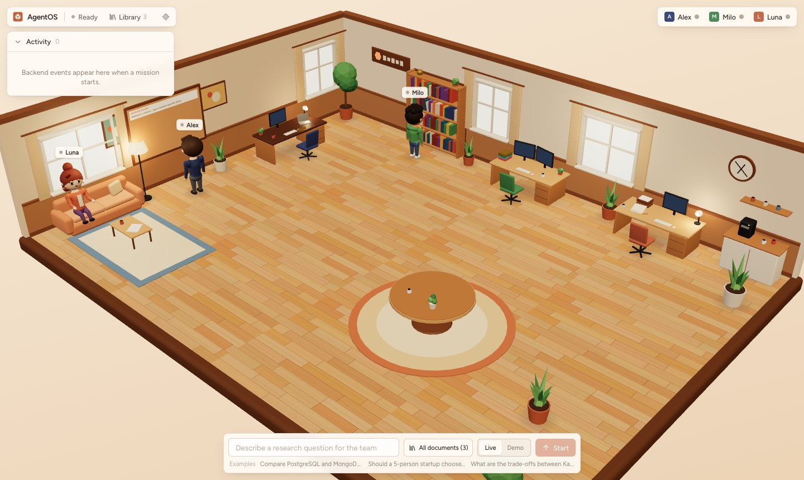
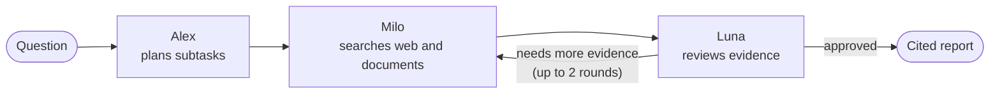

# AgentOS

AgentOS is a 3D office where three AI agents research your questions together. A manager plans the work, a researcher searches the web and your documents, and a reviewer checks the evidence and writes a cited report. Every animation in the office is driven by real backend events, so you can watch the work happen.



## Features

- Multi-agent workflow: a LangGraph pipeline with typed, structured outputs from Claude and a bounded review loop.
- Real-time 3D office: agents walk, type, hand off tasks and present the report as events stream in over SSE.
- Web research through Claude's built-in web search, with every source kept.
- Knowledge Library (RAG): upload PDF, Markdown or text files, embedded locally and searched with Qdrant.
- Cited reports that lead with the answer and adapt to the request (comparison, study plan, explanation and more), with Markdown export.
- Mission history, documents and evidence persist in PostgreSQL. A demo mode runs without an API key.

## Tech stack

| Layer | Technologies |
|---|---|
| Agents | Claude (Anthropic API), LangGraph, LangChain |
| Backend | Python, FastAPI, SQLAlchemy, Alembic |
| Data | PostgreSQL, Qdrant, Sentence Transformers |
| Frontend | React, TypeScript, React Three Fiber (three.js), Zustand, Tailwind CSS, Vite |

## Quick start

Requires Python 3.11+, Node 20+, Docker and an [Anthropic API key](https://console.anthropic.com/).

```bash
# 1. Databases (set AGENTOS_PG_PASSWORD in .env)
cp .env.example .env
docker compose up -d

# 2. Backend (add ANTHROPIC_API_KEY to backend/.env)
cd backend
python3 -m venv .venv
.venv/bin/pip install -r requirements.txt
cp .env.example .env
.venv/bin/alembic upgrade head
.venv/bin/uvicorn main:app --port 8000

# 3. Frontend (in a second terminal)
cd frontend
npm install
npm run dev
```

Open http://localhost:5173, type a question and press Start. Configuration, usage details and tests are in [docs/architecture.md](docs/architecture.md).

## How it works



Each step emits an event. The browser turns the events into app state and into animations in the office. Sources come only from real search results and retrieved passages; citations that don't match a source are removed from the report.

## Limitations

AgentOS runs locally for a single user and is not production-ready. It has no authentication, runs one mission at a time inside the API process, and has no OCR for scanned PDFs. See [docs/architecture.md](docs/architecture.md#not-verified--limitations) for the full list.

---

[MIT License](LICENSE). Inspired by [harishkotra/agent-office](https://github.com/harishkotra/agent-office); this is an independent implementation.
